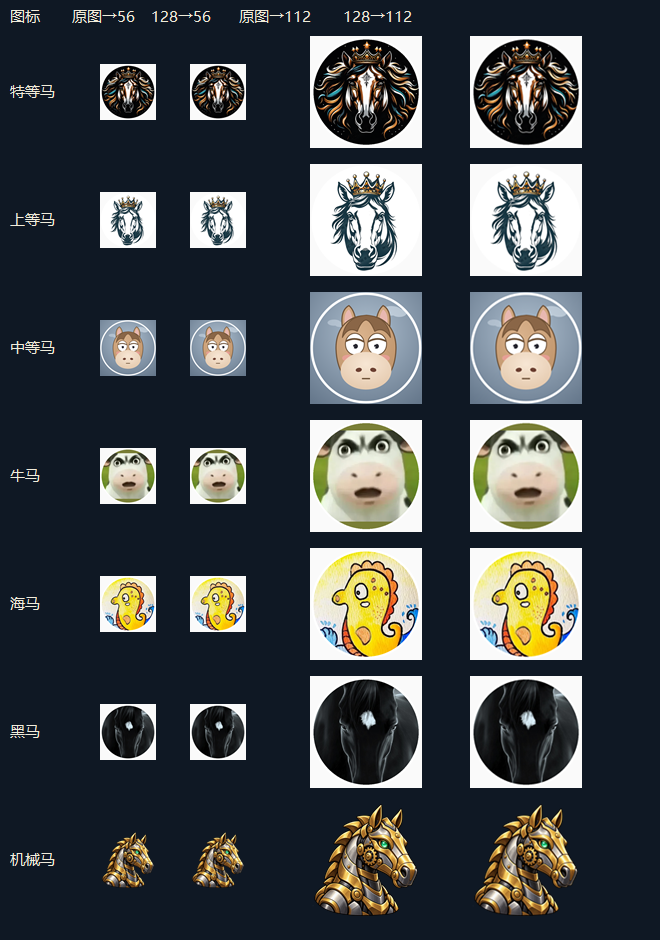

# AI电子马称号与图标（0.3.11）

0.3.7将实际显示框放大到88×88，放在原生ID与称号后方；以下56/112px图片是0.3.6压缩时的离线对照，保留用于说明素材来源。当前仍使用128×128 PNG；88px正常显示无需再增大源图，极高DPI下进一步放大可能变软，真实游戏显示需实测。

## 行为

AI从「电子马·地狱、电子马·极难、电子马·困难、电子马·中等、电子马·简单」中伪随机选一个。以对局ID和UID为种子，按字符做有界取模，刷新、昵称变化、玩家排序、重载不影响同一局结果；不使用运行时会变化的GetHashCode，也不依赖额外存档。新局重新生成，允许恰好选到相同称号。

这些字样仅是装饰，不读取或推测实际AI难度，不参与赔率或积分结算。AI不显示Elo、不影响真人称号排名，不获得黑马与旋转木马；五种称号共用一个机械马Sprite缓存。

## 分辨率与清晰度

界面图标为56×56逻辑单位。原六图均为512×512，新机械马生成原图为1254×1254。离线以高质量双三次插值、像素边界镜像及32位RGBA保存PNG，统一到128×128；不裁剪、不改绘原六图。128px超过正常尺寸的两倍，给112px物理显示留余量。没有压到56或64px，以免高DPI或界面放大时明显模糊。

对照图分别展示原图直接缩到56/112px，以及先缩至128px再显示到56/112px的效果。主要轮廓、颜色及机械马的眼睛/齿轮仍可辨认，两组在这些尺寸下的差别很小。此项是离线素材目视检查，不代表已在真实游戏内验证Canvas或显示器缩放。

| 图标 | 原尺寸 | 原PNG字节 | 128×128 PNG字节 |
|---|---:|---:|---:|
| 特等马 | 512×512 | 287760 | 28462 |
| 上等马 | 512×512 | 176942 | 18048 |
| 中等马 | 512×512 | 145783 | 22095 |
| 牛马 | 512×512 | 136083 | 31654 |
| 海马 | 512×512 | 306796 | 37413 |
| 黑马 | 512×512 | 168661 | 24474 |
| 机械马 | 1254×1254 | 1908995 | 33860 |

原六图从1222025字节减至162146字节，减少约86.7%；加入机械马后七图共196006字节。由于图片同时编入DLL并随素材分发，减小源PNG也会减小DLL中的图片载荷。原六张512px版本仍可从0.3.5及以前的Git历史或用户提供的源码包恢复；本次不修改第三方原作者署名和许可说明。

完整安装ZIP实测由0.3.5的2802778字节（2.80 MB）降至0.3.6的494699字节（0.49 MB），减少82.35%，包含新增的机械马。独立核对七张归档PNG、DLL内嵌图片载荷与工作区素材逐一同哈希，均为128×128；机械马透明通道保留，安装包中的DLL与已通过检查的构建结果一致。

## 机械马生成记录

使用内置imagegen工具，transparent_background=true；生成后仅做上述分辨率缩采样，保留透明背景。最终应用素材为`mod/assets/horse/机械马.png`。未使用API/CLI回退。

实际生成提示词：

> Use case: stylized-concept. Create a single finished raster UI icon for an AI player in a Chinese fantasy strategy card game. Subject: a clearly recognizable mechanical horse head and short neck, three-quarter side profile, an elegant brass and steel automaton with one visible gear at the jaw and a single luminous jade eye. Designed for a tiny 56 by 56 pixel on-screen badge: large bold silhouette, chunky armor plates, thick clean dark outlines, simple broad highlights, very few details, excellent contrast. Friendly but formidable ancient clockwork puppet, polished illustrated game inventory art, not photorealistic. The horse occupies almost the full square canvas with a small even safety margin and no cropping of ears or muzzle. Genuine transparent background. No text, letters, numerals, labels, border, ornamental frame, watermark, extra objects, other horses or background scenery. Ensure it reads instantly as a mechanical horse even at very small size.

## 验证范围

新增五项核心回归覆盖五档范围、同局刷新/重排、重载恢复、新局取种、误传真人分数隔离及连胜/淘汰不覆盖AI称号；官方ILRuntime探针执行同样的稳定选择和机械马映射。构建及静态检查仍使用现有流程。所有AI图标在真实头像列表中的显示及连续切局仍需实机确认。
